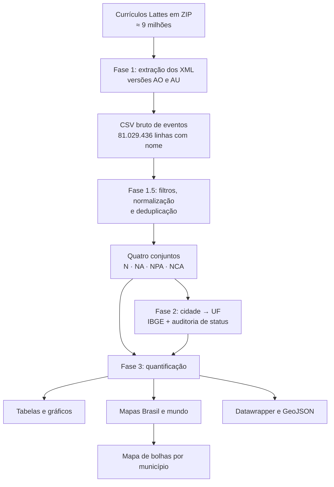

# Magela — Base Nacional de Eventos Acadêmicos em Currículos Lattes


> **Resumo.** Este repositório reúne o código, os dados derivados e os produtos
> analíticos do Projeto Magela: um pipeline de extração, limpeza, normalização,
> deduplicação, quantificação e visualização de **registros de eventos
> acadêmicos** presentes em currículos da Plataforma Lattes (CNPq). A base
> consolidada contém **81.029.436 ocorrências**, distribuídas em quatro
> conjuntos de granularidade crescente, com cobertura temporal de **1900 a
> 2030**, mapeamento cidade → Unidade Federativa e projeções do Brasil e do
> mundo. O material inclui tabelas, gráficos, mapas estáticos e interativos,
> bases para o Datawrapper, arquivos GeoJSON e a documentação metodológica
> completa.

---

## Sumário

- [1. Visão geral](#1-visão-geral)
- [2. Resultados em números](#2-resultados-em-números)
- [3. Estrutura do repositório](#3-estrutura-do-repositório)
- [4. Metodologia](#4-metodologia)
- [5. Formatos de dados](#5-formatos-de-dados)
- [6. Artefatos e resultados](#6-artefatos-e-resultados)
- [7. Documentação](#7-documentação)
- [8. Ambiente e reprodução](#8-ambiente-e-reprodução)
- [9. Qualidade e limitações](#9-qualidade-e-limitações)
- [10. Publicação no GitHub](#10-publicação-no-github)
- [11. Créditos e referências](#11-créditos-e-referências)
- [12. Contribuições](#12-contribuições)

---

## 1. Visão geral

**Objetivo.** Converter o conteúdo dos currículos Lattes em uma base
quantificável de eventos acadêmicos (congressos, seminários, jornadas,
simpósios, salões, semanas acadêmicas etc.), preservando a rastreabilidade de
cada etapa e permitindo análises por nome, ano, país, cidade e Unidade
Federativa.

**Escala.** aproximadamente 9 milhões de currículos em arquivos ZIP; 81.029.436
linhas de eventos com nome após a extração; 29.189.950 chaves distintas no
conjunto mais detalhado. A base organizada ocupa aproximadamente **24,8 GB** em
**17.382 arquivos**, incluindo dados brutos, intermediários, resultados,
ambientes virtuais e documentação.

**Princípios de construção.**

- Nenhum registro é descartado ou corrompido em silêncio: cidade ambígua, não
  encontrada e sem nome recebem status explícito de auditoria.
- Processamento em *streaming*, linha a linha, com `csv.reader` e `csv.writer`
  posicionais — o corpus completo não cabe em memória.
- Nomenclatura e variáveis em português; marcador `##f` no topo dos arquivos
  gerados; constantes de intervalo e de limite de teste no topo dos scripts.
- Os eventos genéricos são **quantificados, nunca removidos**.
- Os textos analíticos usam o termo **registrados**, nunca "citações".

**Escopo do projeto.** Extração dos XML (Fase 1), filtros e construção dos
conjuntos (Fase 1.5), mapeamento cidade → UF (Fase 2), quantificação, tabelas,
gráficos, mapas e exportações (Fase 3).

---

## 2. Resultados em números

### 2.1 Os quatro conjuntos

| Conjunto | Chave de agregação | Chaves distintas | Média | Mediana | Máxima | Chaves com 1 ocorrência | Cobertura do top 10 |
|---|---|---:|---:|---:|---:|---:|---:|
| **N**  | `NOME-DO-EVENTO` | 18.817.656 | 4,31 | 1 | 134.667 | 13.843.554 | 1,15% |
| **NA** | `NOME-DO-EVENTO` + `ANO-DO-EVENTO` | 23.952.738 | 3,38 | 1 | 14.557 | 17.716.360 | 0,13% |
| **NPA** | `NOME-DO-EVENTO` + `PAIS-DO-EVENTO` + `ANO-DO-EVENTO` | 24.366.351 | 3,33 | 1 | 14.554 | 18.126.764 | 0,13% |
| **NCA** | `NOME-DO-EVENTO` + `CIDADE-DO-EVENTO` + `ANO-DO-EVENTO` | 29.189.950 | 2,78 | 1 | 12.210 | 22.454.830 | 0,12% |

As **81.029.436 ocorrências** são idênticas nos quatro conjuntos; o que muda é
a granularidade da chave. Há 13.173 linhas sem nome de evento e nenhuma linha
inválida.

**Máximos observados.**

| Conjunto | Evento | Ocorrências |
|---|---|---:|
| N | `reuniao anual sbpc` | 134.667 |
| NA | `congresso nacional multidisciplinar covid` (2021) | 14.557 |
| NPA | `congresso nacional multidisciplinar covid` (2021) | 14.554 |
| NCA | `congresso brasileiro saude coletiva` (Porto Alegre, 2012) | 12.210 |

No top 10 do conjunto N aparecem também `congresso iniciacao cientifica`
(102.717), `congresso brasileiro enfermagem` (101.950), `seminario iniciacao
cientifica` (91.155) e `reuniao anual sociedade brasileira quimica` (90.735).

### 2.2 Distribuição e série temporal

- A faixa **0–11 ocorrências** é a maior em todos os conjuntos: no N, 18.190.402
  eventos e 28.836.165 ocorrências (35,6% do total); no NCA, 28.424.521 eventos
  e 42.693.406 ocorrências.
- No N, a faixa 10.001–100.000 reúne apenas 334 eventos, mas 7.268.967
  ocorrências — concentração típica de eventos recorrentes de grande porte.
- A série temporal cobre **121 anos (1900–2030)** em NA, NPA e NCA. O pico de
  ocorrências é 2017 (4.288.149 no NA, com 1.186.781 eventos distintos); o
  maior número de eventos distintos no NCA ocorre em 2020 (1.578.145).

### 2.3 Mapeamento cidade → UF

| Status | Chaves | Ocorrências | % das ocorrências |
|---|---:|---:|---:|
| OK | 20.989.890 | 64.024.099 | 79,00% |
| NAO-ENCONTRADO | 4.045.045 | 6.575.212 | 8,11% |
| AMBIGUO | 1.828.675 | 5.660.554 | 6,98% |
| SEM-CIDADE | 2.273.061 | 4.519.996 | 5,58% |
| OK-APELIDO | 53.279 | 249.575 | 0,31% |
| SEM-NOME | 4.248 | 13.173 | 0,02% |

Foram mapeadas **5.266 cidades brasileiras distintas** (contra 5.571
municípios do IBGE) nas **27 UFs**. Há **251 nomes ambíguos**, como `belem`
(AL, PA, PB — 1.512.161 ocorrências), `santa maria` (PA, RN, RS — 847.581) e
`campo grande` (AL, MS — 472.230). São Paulo concentra 14.995.727 ocorrências
(5,7% ambíguas); Acre apresenta a pior qualidade relativa (97,6% ambíguas).
Entre os nomes não encontrados: `online` (350.301), `lisboa` (163.466) e
`paris` (97.893).

### 2.4 Dimensão internacional

O mapa mundial registra **247 países**. Brasil aparece com 77.224.917
ocorrências, Estados Unidos com 799.933 e Portugal com 380.345. Oitenta países
não possuem código ISO-3 e somam 16.062 ocorrências (0,02% do total), listados
em `eventosPorPaisSemCodigo.csv`.

### 2.5 Mapa de bolhas por município

A partir de `eventosPorCidadeUF.csv` e das coordenadas do IBGE: 78.602.414
ocorrências com cidade, das quais 14.328.740 são ambíguas (fora do mapa) e
1.910 não têm coordenada em 5 municípios. Resultado final: **64.271.764
ocorrências em 5.010 municípios**, sem colisões de bolhas, com margem branca de
200 px nas bordas.

---

## 3. Estrutura do repositório

```text
base_eventos/
├── README.md                         # este documento
├── .git/                             # repositório Git (branch Inicial)
├── codigos/                          # pipeline organizado por fase
│   ├── fase1_extracao/               # versões AO e AU (cada uma com .git próprio)
│   ├── filtros_e_conjuntos/          # limpeza, normalização e deduplicação
│   ├── fase2_cidade_uf/              # mapa IBGE e contagens por UF
│   ├── fase3_resultados/             # tabelas, gráficos, mapas e Datawrapper
│   │   └── versao_caminhos_E/        # versão histórica dos scripts (caminhos E:)
│   ├── contabilizacao/               # utilitários de contagem
│   └── utilitarios/                  # mapa de bolhas e coordenadas
├── dados/
│   ├── conjuntos/                    # 9 arquivos RAR (conjuntos e ordenados)
│   ├── csv_bruto/                    # csvBruto.rar
│   ├── csv_filtros/                  # csvFiltro1.rar a csvFiltro5.rar
│   ├── exemplos/                     # amostras dos conjuntos
│   ├── curriculos_exemplo/           # 96 zips de currículos (prefixos 00-99)
│   └── ibge/                         # estados, municípios e coordenadas
├── resultados/
│   ├──atuais/                        # saídas finais + README oficial
│   │   ├── graficos/  mapas/  tabelas/  dw/  geo/
│   └── geracao_anterior/             # saídas antigas (Conjunto1..4)
├── documentacao/
│   ├── agentes/                      # AGENTS.md (convenções do projeto)
│   ├── dicas_e_historico/            # Dicas.txt, maisInformacoes.txt, README antigo
│   └── apresentacao/                 # panoramaEventos_p&e.pdf
├── ambiente/
│   ├── venv_python313/               # Python 3.13.16 com pandas, matplotlib, geopandas…
│   ├── venv_python314/               # Python 3.14.8 (sem bibliotecas de análise)
│   └── ide/                          # configurações de IDE
├── snapshot_magela_zip/              # Magela.zip e seu conteúdo original
├── base_de_dados.rar                 # arquivo completo da pasta dados/ (12,3 GB)
├── extratorEventosFinal.py           # scripts avulsos da raiz
├── geradorConjuntosG.py
├── tratamentoEventosG.py
├── dados_para_excel.py
├── quant_ocorrencias.py
└── maisInformacoes.txt
```

| Área | Conteúdo | Volume observado |
|---|---|---:|
| `dados/` | RARs de origem, conjuntos extraídos, amostras, tabelas do IBGE | ≈12,2 GB |
| `base_de_dados.rar` | Cópia compactada de `dados/` | 12,3 GB |
| `resultados/` | Saídas finais e geração anterior | dezenas de MB |
| `codigos/` | Scripts das quatro fases e utilitários | arquivos de texto |
| `documentacao/` | Memória metodológica, convenções e apresentação | ≈7,4 MB |
| `ambiente/` | Dois ambientes Python e configuração de IDE | ≈387 MB |
| `snapshot_magela_zip/` | Snapshot integral do zip original | ≈216 MB |

---

## 4. Metodologia



### 4.1 Extração dos currículos (Fase 1)

Duas versões de extratores são mantidas, com finalidades distintas:

- **AO** (`codigos/fase1_extracao/versao_antiga_AO/`): primeira leitura, com
  `extratorEventosPrimeiraLeitura.py`, `extratorEventosSegundaLeitura.py`,
  `extrator_preprint.py`, `pegarAlgumasLinhas.py` e
  `quantificadorOcorrencais.py`.
- **AU** (`codigos/fase1_extracao/versao_nova_AU/`): leitura final, com
  `extratorEventosFinal.py`, `extratorEventosSegundaLeitura.py`,
  `extrator_preprint.py`, `filtroEventosINICIALCSV.py`, `novoQuantificar.py` e
  `pegararquivos.py`.

As versões **não são intercambiáveis**: os esquemas diferem em detalhes como o
campo `ORGANIZACAO-DE-EVENTO`, preenchido com `TITULO` na segunda leitura da
versão AU. Cada diretório preserva seu histórico Git e amostras em `CSVTestes/`
e `CSVMagela/`.

O CSV bruto de eventos usa `;` e contém 12 colunas: `IDENTIFICADOR`,
`TIPO-REGISTRO`, `NOME-DO-EVENTO`, `TIPO-DE-EVENTO`,
`CLASSIFICACAO-DO-EVENTO`, `ANO-DO-EVENTO`, `PAIS-DO-EVENTO`,
`CIDADE-DO-EVENTO`, `LOCAL-DO-EVENTO`, `CODIGO-INSTITUICAO-PROMOTORA`,
`INSTITUICAO-PROMOTORA` e `DURACAO-EM-SEMANAS`. O extrator de artigos/preprints
(`extrator_preprint.py`) gera 24 colunas com delimitador `,`.

### 4.2 Filtros e normalização (Fase 1.5)

Aplicados em sequência sobre o CSV bruto, os filtros estão documentados em
`documentacao/dicas_e_historico/maisInformacoes.txt`:

1. remoção de eventos sem nome e com informações vazias;
2. remoção de duplicatas exatas;
3. limpeza de `CIDADE-DO-EVENTO` (mantido apenas o texto antes de pontuação);
4. normalização geral — minúsculas, sem acentos, sem pontuação, sem algarismos,
   sem espaços extras e sem stopwords;
5. nova remoção de duplicatas, repetida também após a geração dos conjuntos.

As saídas intermediárias `csvFiltro1.rar` a `csvFiltro5.rar` correspondem a
essas etapas.

### 4.3 Conjuntos de deduplicação

| Sigla | Arquivo | Colunas (delimitador `\|`) |
|---|---|---|
| N | `conjuntoN_ordenado.csv` | `NOME-DO-EVENTO\|OCORRENCIAS-EVENTO` |
| NA | `conjuntoNA_ordenado.csv` | `NOME-DO-EVENTO\|ANO-DO-EVENTO\|OCORRENCIAS-EVENTO-ANO` |
| NPA | `conjuntoNPA_ordenado.csv` | `NOME-DO-EVENTO\|PAIS-DO-EVENTO\|ANO-DO-EVENTO\|OCORRENCIAS-EVENTO-PAIS-ANO` |
| NCA | `conjuntoNCA_ordenado.csv` | `NOME-DO-EVENTO\|CIDADE-DO-EVENTO\|ANO-DO-EVENTO\|OCORRENCIAS-EVENTO-CIDADE-ANO` |

> **Nota histórica.** A geração antiga usa os nomes `Conjunto1` a `Conjunto4`.
> Naquele esquema, o Conjunto4 era `NOME|ANO|PAIS|CIDADE`; o NCA atual **não
> contém país**. As saídas antigas ficam isoladas em
> `resultados/geracao_anterior/` para evitar mistura de gerações.

### 4.4 Mapeamento cidade-UF (Fase 2)

O XML do Lattes não contém UF para registros de evento: ela é derivada do nome
da cidade por cruzamento com a base de municípios do IBGE (repositório
`kelvins/municipios-brasileiros`, cujas cópias estão em `dados/ibge/`). A ordem
dos scripts em `codigos/fase2_cidade_uf/` é:

```text
mapaCidadeUF.py        → mapaCidadeUF.json (cidade normalizada → UF ou AMBIGUO)
geradorNomeEstado.py   → nomeEstado.csv (com STATUS-MAPEAMENTO)
contadorOcorrencias.py → contagemPorNome, contagemPorNomeCidade, contagemPorNomeUF
```

Cada saída carrega um status explícito (`OK`, `OK-APELIDO`, `AMBIGUO`,
`NAO-ENCONTRADO`, `SEM-CIDADE`, `SEM-NOME`). Nomes presentes em mais de uma UF
nunca recebem uma sigla arbitrária. Como `normalizacaoGeral.py` remove
stopwords de cidade (com proteção apenas para `sao`), o mapa usa chaves
heurísticas para recuperar casos como "São José dos Campos".

### 4.5 Quantificação e visualização (Fase 3)

Scripts em `codigos/fase3_resultados/`, executados nesta ordem:

```text
tabelas.py              → top10, série anual, faixas e resumo
graficos.py             → PNGs de ano, faixas e top 10
dadosMapaMundial.py     → países, ISO-3 e séries por país/ano
dadosMapaBrasil.py      → UF, cidade/UF e relatórios de mapeamento
gerarVisualizacao.py    → graficos/, mapas/, tabelas/ e geo/
tabelasDatawrapper.py   → dw/ (13 CSVs)
top10Genericos.py N     → top 10 genérico/não genérico (repetir para NA, NPA, NCA)
graficosGenericos.py    → PNGs dos top 10 separados
```

Parâmetros adotados na geração final: `LIMITE_TESTE = None` (corpus completo),
`ANO_MIN = 1900`, `ANO_MAX = 2030`, `TAMANHO_TOP = 10` e
`LIMITES_FAIXAS = [0, 12, 21, 51, 101, 201, 501, 1001, 5001, 10001, 100001]`
(faixas 0–11, 12–20, 21–50, 51–100 e assim por diante).

**Critério genérico × não genérico.** É genérico o nome formado apenas por tipo
de evento mais tema amplo de atividade acadêmica — iniciação científica,
extensão, ensino, pesquisa, ciência e tecnologia, semana acadêmica — sem sigla,
instituição ou nome próprio (ex.: `congresso iniciacao cientifica`, com
102.717 ocorrências). É não genérico o nome que possui algum qualificador
identificador (ex.: `reuniao anual sbpc`, com 134.667). Nenhum dos dois grupos é
removido da base.

**Mapa de bolhas.** `codigos/utilitarios/bolhasMunicipios.py` lê
`eventosPorCidadeUF.csv`, descarta cidades ambíguas e usa área proporcional à
raiz quadrada do número de ocorrências. As saídas estão em `resultados/atuais/mapas/`.

---

## 5. Formatos de dados

| Tipo de arquivo | Delimitador | Local |
|---|---|---|
| CSV de eventos da extração | `;` | `dados/csv_bruto/`, `dados/csv_filtros/` |
| CSV de artigos/preprints | `,` | scripts `extrator_preprint.py` |
| Conjuntos ordenados | `\|` | `dados/conjuntos/` |
| Saídas analíticas | `;` | `resultados/atuais/` |
| Exportações para o Datawrapper | `,` | `resultados/atuais/dw/` |
| Geodados | JSON | `resultados/atuais/geo/` |
| Visualizações | PNG, HTML, XLSX | `resultados/atuais/graficos/`, `mapas/`, `tabelas/` |

Os delimitadores **não devem ser misturados**: o mesmo arquivo lido com o
separador errado produz uma única coluna e falhas de parsing silenciosas.

Esquemas das principais saídas:

```text
eventosPorAno.csv       CONJUNTO;ANO;DISTINTOS;OCORRENCIAS
eventosPorFaixas.csv    CONJUNTO;INICIO;FIM;FAIXA;QTD-EVENTOS;OCORRENCIAS
eventosPorPais.csv      PAIS-DO-EVENTO;OCORRENCIAS;EVENTOS-DISTINTOS;ANO-MIN;ANO-MAX;CODIGO-ISO3
relatorioMapeamento.csv STATUS;CHAVES;OCORRENCIAS;PERCENTUAL-CHAVES;PERCENTUAL-OCORRENCIAS
```

---

## 6. Artefatos e resultados

`resultados/atuais/README.md` é o resumo oficial dos números. Os arquivos da
geração final estão distribuídos assim:

| Pasta | Arquivos | Conteúdo |
|---|---:|---|
| raiz | 28 | `resumo.csv`, top 10 dos quatro conjuntos (inclusive genérico/não genérico), séries por ano, faixa, país e UF, relatórios de mapeamento e PNGs principais |
| `graficos/` | 15 | série anual, distribuição por faixas, top 10 dos quatro conjuntos e as oito variações genérico/não genérico, eventos por UF |
| `mapas/` | 13 | Brasil e mundo em PNG e HTML interativo, mapa de bolhas (`bolhasMunicipios.png`, `bolhasMunicipios_margem.png`, `bolhasMunicipios.html`), `municipiosSemCoordenada.csv` |
| `tabelas/` | 3 | `tabelas_formatadas.xlsx`, tabelas para Datawrapper (UF e países) |
| `dw/` | 13 | CSVs prontos para o Datawrapper: UF, UF por década, países com e sem Brasil, países por década, cidades com coordenada, cidades para revisão, série anual, faixas em colunas e top 10 |
| `geo/` | 2 | `brasil_uf.geojson`, `paises.geojson` |

`resultados/geracao_anterior/` guarda 23 arquivos da geração antiga
(`Conjunto1..4_quantificado.csv`, `top10_Conjunto*.csv`, `normalizado.csv`
entre outros). Eles permanecem como registro histórico e **não** fazem parte do
resumo oficial.

A auditoria das cidades sem coordenada (`municipiosSemCoordenada.csv`) lista
`pedro` (PI, 1.690 ocorrências), `sao luis paraitinga` (SP, 115), `sao caitano`
(PE, 88), `governador sept rosado` (RN, 11) e `augusto severo` (RN, 6).

---

## 7. Documentação

| Documento | Finalidade |
|---|---|
| `resultados/atuais/README.md` | Resumo oficial de números, conjuntos, mapeamento e arquivos |
| `documentacao/agentes/AGENTS.md` | Convenções de escrita, mapa de diretórios, histórico, delimitadores e receita de execução |
| `documentacao/dicas_e_historico/Dicas.txt` | Racional do mapeamento cidade → UF, ambiguidades do IBGE e cuidados com stopwords |
| `documentacao/dicas_e_historico/maisInformacoes.txt` | Ordem dos filtros aplicados ao CSV bruto e link da pasta compartilhada com os CSVs |
| `documentacao/dicas_e_historico/versao_codigos/maisInformacoes.txt` | Versão alternativa do histórico de filtros |
| `documentacao/dicas_e_historico/README_raiz_anterior.md` | README original da raiz, preservado antes desta atualização |
| `documentacao/apresentacao/panoramaEventos_p&e.pdf` | Material de apresentação do panorama de eventos |
| `codigos/fase3_resultados/README.md` | Notas da suíte de resultados da fase 3 |
| `snapshot_magela_zip/` | `Magela.zip` e seu conteúdo original, extraído sem mesclagem para preservar os históricos Git |

---

## 8. Ambiente e reprodução

**Interpretadores preservados em `ambiente/`.**

- `venv_python313/`: Python 3.13.16 com `pandas`, `matplotlib`, `geopandas`,
  `plotly`, `openpyxl` e `nltk` — **usar este para a Fase 3**.
- `venv_python314/`: Python 3.14.8, sem `pandas`/`matplotlib` — adequado apenas
  aos extratores da Fase 1.

```powershell
$py = 'D:\BACKUP\base_eventos\ambiente\venv_python313\Scripts\python.exe'
& $py codigos\fase3_resultados\tabelas.py
& $py codigos\fase3_resultados\graficos.py
& $py codigos\fase3_resultados\dadosMapaMundial.py
& $py codigos\fase3_resultados\dadosMapaBrasil.py
& $py codigos\fase3_resultados\gerarVisualizacao.py
& $py codigos\fase3_resultados\tabelasDatawrapper.py
& $py codigos\fase3_resultados\top10Genericos.py N
& $py codigos\fase3_resultados\top10Genericos.py NA
& $py codigos\fase3_resultados\top10Genericos.py NPA
& $py codigos\fase3_resultados\top10Genericos.py NCA
& $py codigos\fase3_resultados\graficosGenericos.py
& $py codigos\utilitarios\bolhasMunicipios.py
```

**Observações operacionais.**

- Os caminhos são **hardcoded no topo dos scripts**; ajuste-os antes da primeira
  execução. Não há arquivo de configuração nem argumentos de linha de comando
  generalizados (exceto `top10Genericos.py`).
- `dadosMapaBrasil.py` processa 29,19 milhões de linhas e leva cerca de 85 s no
  conjunto NCA.
- As stopwords do NLTK estão em
  `C:\Users\Usuario\AppData\Roaming\nltk_data`. Para download via proxy, definir
  `NLTK_ALLOW_PROXIED_URLOPEN=1`.
- Para extrair os RAR: `"C:\Program Files\WinRAR\Rar.exe" x -y <arquivo.rar> <destino>`.
  Em disco com pouco espaço, extraia um conjunto por vez.
- Valide qualquer alteração contra uma amostra real antes de rodar sobre o
  corpus completo.

---

## 9. Qualidade e limitações

- A UF é inferida; cerca de 7% das ocorrências são ambíguas e ficam fora das
  contagens por Unidade Federativa, com status explícito.
- A remoção de stopwords em `CIDADE-DO-EVENTO` prejudica o casamento exato com
  o IBGE; há casamento heurístico (`OK-APELIDO`), mas a correção ideal seria
  aplicada na normalização.
- Cidades como `online`, `lisboa` e `paris` aparecem como não encontradas na
  base brasileira; eventos no exterior são identificados pelo país.
- Cinco municípios mapeados não possuem coordenada e ficam de fora do mapa de
  bolhas; a lista está disponível para revisão.
- Oitenta países sem código ISO-3 não aparecem na projeção cartográfica, mas
  são quantificados em `eventosPorPaisSemCodigo.csv`.
- O Lattes registra a participação declarada pelo pesquisador; a base mede
  **registros**, não a presença física ou a qualidade do evento.
- A maior parte das chaves tem uma única ocorrência (73,6% no N a 76,9% no
  NCA). Isso é uma característica da distribuição, não um filtro de ruído.
- **Atenção semântica:** em `resumo.csv`, as colunas `EVENTOS-GENERICOS` e
  `OCORRENCIAS-GENERICAS` significam *chaves com exatamente uma ocorrência* —
  são diferentes do critério temático genérico/não genérico dos arquivos
  `top10_*_genericas.csv` e `top10_*_nao_genericas.csv`.

---

## 10. Publicação no GitHub

O repositório remoto configurado em `.git/config` é
`https://github.com/lucasjosehvs/PIBICJr_Construcao_Base_Nacional_Curada_Consulta_Normalizacao_Certificacao_Eventos.git`,
com a branch local `Inicial`.

A base completa **não deve ser enviada diretamente** para o GitHub:
`base_de_dados.rar` (12,3 GB), `dados/` (≈12,2 GB) e parte dos ambientes
virtuais ultrapassam o limite de 100 MB por arquivo e o tamanho recomendado de
repositório. Para a atualização, recomenda-se versionar código, resultados e
documentação e manter os dados volumosos fora do histórico Git, usando
`.gitignore` para `dados/`, `ambiente/`, `snapshot_magela_zip/`, `*.rar`,
`*.zip`, `__pycache__/` e `resultados/atuais/*.zip`. Se algum conjunto precisar
ser versionado, avalie Git LFS ou armazenamento externo — o link da pasta
compartilhada com os CSVs está em `maisInformacoes.txt`.

---

## 11. Créditos e referências

- **Fonte primária:** Plataforma Lattes do CNPq — currículos públicos em formato
  XML, agregados em ZIP.
- **Referência geográfica:** Instituto Brasileiro de Geografia e Estatística
  (IBGE), por meio da base `municipios.csv` / `estados.csv` do repositório
  `kelvins/municipios-brasileiros`.
- **Ferramentas:** Python (biblioteca padrão `csv`, `zipfile`,
  `xml.etree.ElementTree`), pandas, NLTK, Matplotlib, GeoPandas, Plotly,
  OpenPyXL, WinRAR e Datawrapper.
- **Projeto:** Projeto Magela — PIBIC Jr., construção de base nacional curada
  para consulta, normalização e certificação de eventos acadêmicos.

Os dados derivados de currículos públicos devem ser utilizados em conformidade
com as políticas de uso da Plataforma Lattes/CNPq.

---

## 12. Contribuições

Contribuições e revisões de esquema são bem-vindas. Abra uma *issue*
descrevendo o problema e, quando possível, inclua uma amostra de dado que
reproduza o caso. Ao propor alterações, mantenha as convenções do projeto
(linguagem em português, processamento em *streaming*, delimitadores por tipo de
arquivo, terminologia "registrados" e preservação integral dos registros) e
sincronize as duas cópias dos scripts da Fase 3 (a dos caminhos `D:` em
`codigos/fase3_resultados/` e a histórica dos caminhos `E:` em
`codigos/fase3_resultados/versao_caminhos_E/`).
